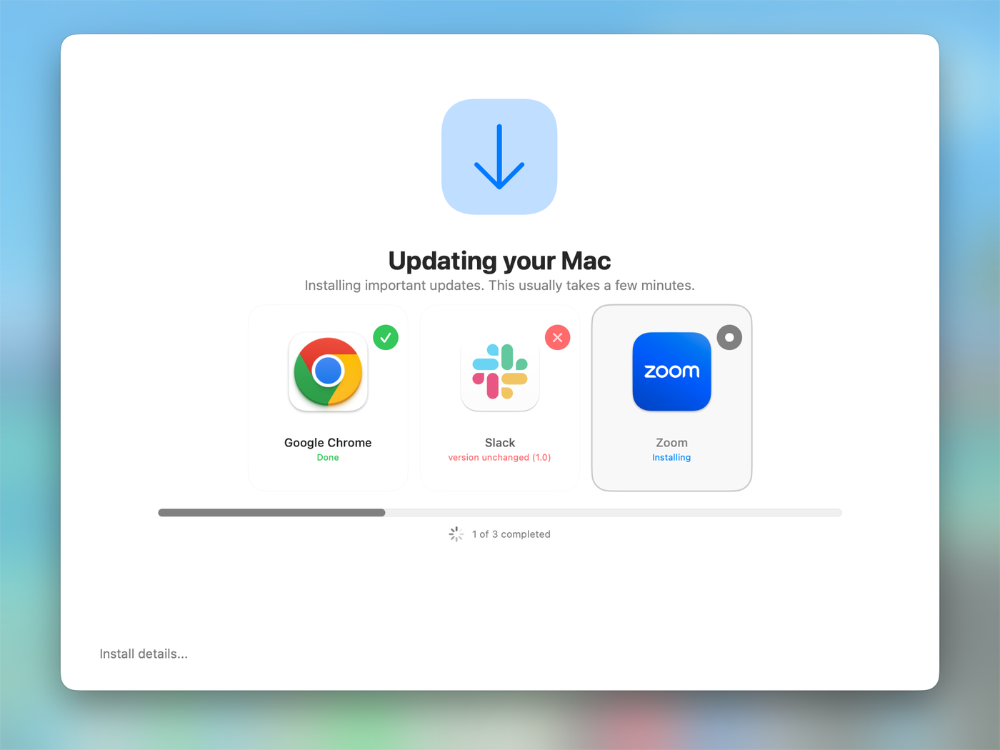
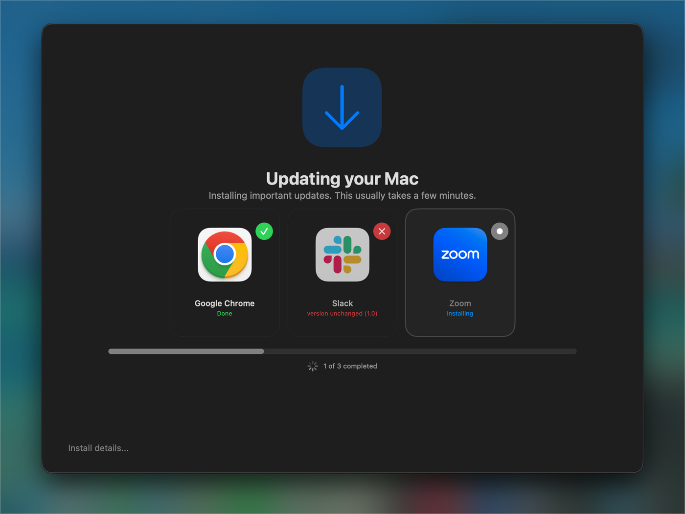

# Threshold

**Updates Mac apps at login, before anyone starts working.**

At the first login after a restart, Threshold checks the apps you choose. If any are out of date, it blurs the screen, installs the updates, confirms they worked, and hands over the desktop. If everything is current, the user sees nothing.

- **Set up through your MDM.** One configuration profile, nothing for users to click.
- **Never traps anyone.** The blur always lifts after a time limit (5 minutes by default).
- **Installs from Jamf policies or packages already on the Mac.** Cached packages are ideal for VPN clients, since they don't need the network.
- **Gives up on broken updates.** An update that keeps failing stops retrying, so it can't block every login.

## What users see

Each app gets a card: a green check when it's updated, a red ✕ with the reason if it fails, and the one being installed highlighted. The window follows the user's light or dark mode.

| Light mode | Dark mode |
|---|---|
|  |  |

*Example run with test packages: Google Chrome updated, Slack failed (simulated: the installer ran but the version didn't change), Zoom installing.*

Prefer a plain list? Set **Window style** to Classic in the profile.

## Get started

1. **Install swiftDialog** 3.0.1 or later on your Macs.
2. **Deploy the package.** Download `Threshold-<version>.pkg` from [Releases](https://github.com/qlabssoftware/threshold/releases/latest) and push it with your MDM.
3. **Deploy a configuration profile** that lists the apps to keep updated.
4. **Restart a test Mac and log in.**

Step-by-step instructions are in the [Getting Started guide](https://github.com/qlabssoftware/threshold/wiki/Getting-Started).

## Requirements

- Apple silicon, macOS 14 or later
- [swiftDialog](https://github.com/swiftDialog/swiftDialog) 3.0.1 or later (2.5.0 works, with the classic window)
- An MDM that can deploy a custom configuration profile
- Jamf Pro, only if you install updates through Jamf policies

## Documentation

Everything else is in the **[wiki](https://github.com/qlabssoftware/threshold/wiki)**:

- [How It Works](https://github.com/qlabssoftware/threshold/wiki/How-It-Works)
- [Configuration Reference](https://github.com/qlabssoftware/threshold/wiki/Configuration-Reference)
- [Recipes](https://github.com/qlabssoftware/threshold/wiki/Recipes)
- [Results and Monitoring](https://github.com/qlabssoftware/threshold/wiki/Results-and-Monitoring)
- [Troubleshooting](https://github.com/qlabssoftware/threshold/wiki/Troubleshooting)
- [Security and Trust](https://github.com/qlabssoftware/threshold/wiki/Security-and-Trust)
- [Uninstall](https://github.com/qlabssoftware/threshold/wiki/Uninstall)
- [FAQ](https://github.com/qlabssoftware/threshold/wiki/FAQ)

## Acknowledgements

Threshold wouldn't be possible without [swiftDialog](https://github.com/swiftDialog/swiftDialog) by **Bart Reardon**. The blurred full-screen window, the app cards and progress list, and the "still updating" message are all swiftDialog. Huge thanks to Bart and everyone who contributes to swiftDialog for building and maintaining such a great tool for the Mac admin community. 🙏

swiftDialog is MIT-licensed and installed separately; Threshold doesn't include it.

## License

Apache License 2.0. See [LICENSE](LICENSE) and [NOTICE](NOTICE).
